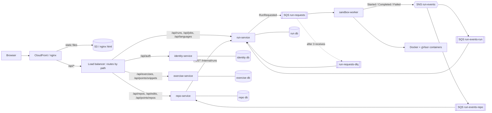
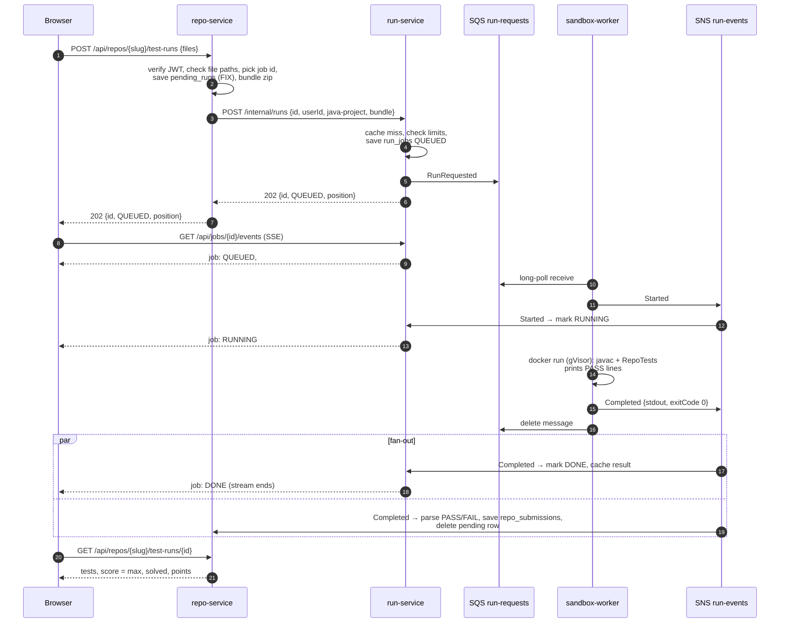

# Architecture

Read the Code is split into five backend services, a static frontend, and a sandbox that runs user code. This page covers what each part owns and how they talk to each other. It then follows a single request end to end: a user submits a correct fix for a repo exercise.

## The parts

### Services

| Service | Module | Owns | Database tables |
|---|---|---|---|
| identity | `identity-service` | Google sign-in, users, signing the JWT, publishing its public key at `/api/auth/jwks` | users |
| exercise | `exercise-service` | Snippet exercises (predict output, trace, spot the bug), attempts, grading, snippet points | exercises, attempts |
| repo | `repo-service` | Repo exercises, Claude-graded reviews, test-run history, repo points, each exercise's baseline | repo_exercises, repo_submissions, pending_runs |
| run | `run-service` | Run jobs and their status, the result cache, live job updates over Server-Sent Events | run_jobs, run_cache |
| sandbox worker | `sandbox-worker` | Takes runs off the queue and executes them in locked-down containers | none |

The web services run without state, so any instance can serve any request. Each one has its own database and login on a single Postgres instance, which means no service can read another service's tables.

### Shared libraries (not services)

| Module | Contents |
|---|---|
| `contracts` | Message and response types shared across services: `RunRequested`, `RunEvent`, `RunResult`, `JobView`, and the sandbox language config |
| `messaging` | `MessageSender` (SQS send, SNS publish) and `QueueListener` (long-polls one SQS queue) |
| `platform` | JWT checking, `@CurrentUser`, the rate limiter, and error responses, all shared by the web services |
| `content-tests` | CI only: runs every exercise's answer in the real sandbox, so a wrong answer fails the build |

### How the services talk

| From → to | How | Why that way |
|---|---|---|
| Browser → any service | HTTPS. The edge routes requests by path prefix | One origin for the browser. Services stay separate behind it |
| Any service checks sign-in | Locally: it verifies the JWT in the `cc_session` cookie against identity's public key (JWKS) | Services don't call identity for each request |
| repo → run | Synchronous `POST /internal/runs` | The browser needs the job id back right away. `/internal` has no public route |
| run → worker | SQS `run-requests` queue | A buffer for bursts. The visibility timeout retries a run whose worker died. After 3 receives a message moves to the dead-letter queue |
| worker → run, repo | SNS `run-events` topic, with one SQS queue per subscriber | The worker doesn't need to know who is interested in a result |

Delivery is at least once and in no guaranteed order, so every message handler is idempotent:
- run-service only moves a job forward (QUEUED → RUNNING → DONE/FAILED).
- repo-service records a run only if the job is listed in `pending_runs`, and `job_id` is unique on submissions.

### Where it runs

| | Local (`docker-compose.yml`) | AWS (`deploy/aws`, CDK) |
|---|---|---|
| Edge | nginx in the frontend container (`frontend/nginx.conf`) | CloudFront: S3 for static files, `/api/*` to an ALB |
| Web services | Containers | ECS Fargate, scaled on CPU, found by name through Service Connect |
| Worker | Container with the Docker socket | ECS on an EC2 Auto Scaling group with gVisor installed, scaled on queue depth. Fargate can't run Docker or gVisor |
| Database | One Postgres container, one database per service | One RDS Postgres instance, one database per service |
| Queues | LocalStack (`deploy/local/localstack-init.sh`) | SQS and SNS |
| Content | `exercise-seed` and `repo-seed` one-off containers | One-off seed tasks on Fargate |

### The sandbox

Every run is a fresh `docker run` (`DockerSandbox`) with these settings:
- gVisor runtime (`runsc`)
- `--network none` and `--read-only`
- a 64 MB `/tmp` as the only writable space
- 256 MB of memory, 1 CPU, 64 processes
- all capabilities dropped and `no-new-privileges`
- runs as user `nobody`
- a time limit per language (20 s for a Java project)

Each worker runs at most 4 containers at a time.

---

## Flow: a user submits a correct fix for a repo exercise

The setup: the user opened a repo exercise and found the bugs. They edited the project files in the browser and clicked **Run hidden tests**. Their fix is correct, so every hidden test will pass.

### Step by step

**1. The browser submits the edited files.**
`api.testRun` sends `POST /api/repos/{slug}/test-runs` with `{ files: { path: content } }`. It includes the `cc_session` cookie and a CSRF token. The edge routes `/api/repos` to repo-service.

**2. repo-service checks the request and records what it expects** (`RepoController.testRun` → `RepoService.runTests`).
- The `platform` security filter verifies the JWT signature against identity's public key. `@CurrentUser` turns the token's subject into the user id.
- Every edited path must be a file in the exercise. An unknown path returns 400.
- repo-service picks the job id and saves it in `pending_runs` with purpose `FIX` *before* calling run-service. If run-service answers from its cache, the result event can arrive almost at once, and repo-service has to know the id by then or it would ignore the event.
- `RepoScoring.bundle` builds the project with the user's edits, adds the hidden tests, and zips it all as base64. The zip is deterministic (sorted entries, zero timestamps), so the same code always gives the same bytes and can hit the cache.

**3. repo-service hands the run to run-service.**
`HttpRunClient` sends `POST /internal/runs` with `{id, userId, language: "java-project", code: bundle}`. The timeouts are short (2 s to connect, 5 s to read), so a slow run-service fails the request rather than tying up threads. If the call fails, repo-service deletes the pending row.

**4. run-service queues the job** (`JobService.submitInternal` → `enqueue`).
- The language must be one the sandbox knows.
- If the same id was already submitted, run-service returns that job (so a retried call is safe).
- It looks up `sha256(language + code)` in the run cache. This time it's a miss, so it goes on:
  - a user may have at most 2 runs in flight (429 otherwise), and the queue holds at most 500 waiting runs (503 otherwise);
  - then the per-user rate limit (20 runs a minute by default).
- It saves the job in `run_jobs` as `QUEUED`, then sends `RunRequested` to the SQS `run-requests` queue. A database write and a queue send can't be one transaction. So if the send fails, the job stays QUEUED with no `sent_at`, and a sweep every 10 s sends it again.
- It returns `202` with the job id, status and queue position. repo-service passes that straight back to the browser.

*(Cache hit instead: run-service saves the job as DONE right away and publishes `Completed` with `cached: true` on SNS, so repo-service still learns the result the same way. The browser gets a 200.)*

**5. The browser follows the job** (`followTestRun` → `followJob`).
It opens `GET /api/jobs/{id}/events` on run-service, a Server-Sent Events stream. It reads the stream with `fetch` rather than `EventSource` so the request carries the same headers as all the others. `JobEvents` loads every job its open streams are waiting on in one query every 250 ms, and sends an event only when a job changes. The button shows "Queued, #1 in line", then "Running". If the stream drops, the browser reconnects and gets the current state first.

**6. A worker runs the tests** (`JobWorker.process`).
- The worker long-polls SQS, asking for only as many messages as it has free slots.
- It publishes `Started` on SNS. run-service marks the job RUNNING.
- `DockerSandbox` runs the `java-project` language in a fresh gVisor container: decode the bundle, unzip, `javac` everything, then run `RepoTests`. The tests print one line each: `PASS <name>` or `FAIL <name>: <reason>`. With a correct fix every line is `PASS` and the exit code is 0.
- The worker publishes `Completed {jobId, result}` on SNS and only then deletes the SQS message. If the worker dies before the delete, the message reappears after the 2-minute visibility timeout and another worker runs it.

**7. SNS delivers the result to both subscribers.** Each one has its own SQS queue, so they process it independently.

**8. run-service marks the job DONE** (`RunEvents.onRunEvent`).
`complete()` updates the row only while the job is still QUEUED or RUNNING, so a duplicate event changes nothing. The result is cached because it depends only on the code, not on a timeout or a sandbox error. On its next 250 ms tick, `JobEvents` sends `DONE` with the run output and closes the stream.

**9. repo-service records and scores the run** (`RepoRunEvents.onRunEvent`, all in one transaction).
- It looks up the job in `pending_runs`. It's there with purpose `FIX`.
- `RepoScoring.recordTestRun` parses the PASS/FAIL lines. Every test passed and the exit code is 0, so it saves a `repo_submissions` row of kind `FIX` with `score = maxScore` and the job id.
- It deletes the pending row in the same transaction. A duplicate event then finds no pending row, and the unique `job_id` is a second guard.

**10. The browser fetches the scored result.**
Once the job is DONE, `followTestRun` calls `GET /api/repos/{slug}/test-runs/{jobId}` on repo-service. Step 9 can finish a moment after step 8, so a 404 ("not recorded yet") is retried every 250 ms, up to 20 times. This is eventual consistency between the two services, and the user can see it as a short pause.

The response lists each test as passed, `solved: true`, and the points. With every test passing, the user gets the exercise's full points: 50 for easy, 100 for medium, 150 for hard (`RepoPoints`). The exercise list now shows it as SOLVED.

**11. Points are never stored.**
They are worked out from the user's best test run for each exercise. The page header asks each service for its own total (`/api/points/snippets` and `/api/points/repos`) and adds them up.

### What changes when the fix is only partly right

Steps 1 to 8 are the same. In step 9 some tests print `FAIL`, so the score is the number of tests that passed. Points come from tests that *this user* made pass: tests that already pass on the untouched code (the exercise's baseline) earn nothing. Those points share 80% of the maximum, and the last 20% is a bonus for passing every test. A later, better run raises the score, and a worse one never lowers it, because points come from the best run.

### What can go wrong, and what handles it

| Failure | What happens |
|---|---|
| run-service is down when repo-service calls it | The call fails within seconds, the pending row is deleted, and the user sees "Code runs are unavailable, try again" |
| Sending to SQS fails after the job is saved | The job stays QUEUED with no `sent_at`, and the sweep sends it again within about 10 to 40 s |
| A worker crashes mid-run | The message was never deleted, so it reappears after 2 minutes for another worker |
| The code crashes every worker that runs it | After 3 receives SQS moves the message to the dead-letter queue, and run-service marks the job FAILED |
| An event arrives twice | run-service's forward-only updates and repo-service's pending row and unique `job_id` make the second one change nothing |
| A job never finishes at all | run-service fails anything older than 15 minutes |
| A user calls run-service directly with code that prints `PASS` | It earns nothing: only jobs repo-service put in `pending_runs` get recorded |
