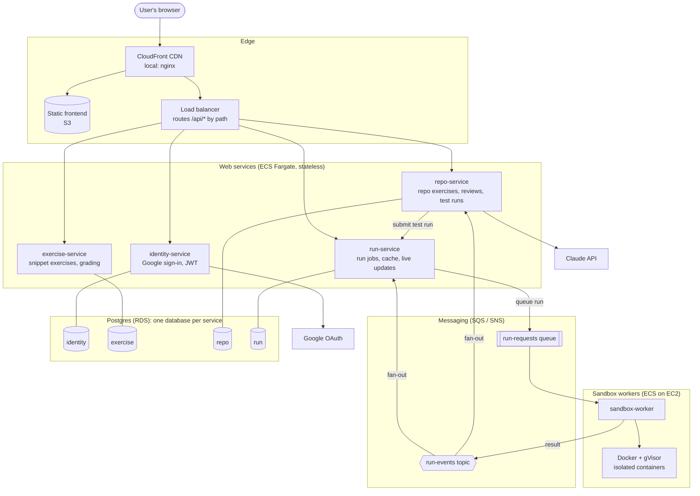

# High-level design

The whole system on one page. For what each part owns and how a request moves through it, see [ARCHITECTURE.md](ARCHITECTURE.md).

## How to read it

| Layer | What it does |
|---|---|
| **Edge** | Serves the frontend and sends `/api/*` calls to the right service by path |
| **Web services** | Four stateless services split by domain. Each checks the sign-in token itself, using identity's public key |
| **Messaging** | Code runs are queued, not run inline. Results are published once and delivered to every service that needs them |
| **Sandbox workers** | Run untrusted code in throwaway containers with no network, under gVisor. They have no database |
| **Data** | One Postgres instance, a separate database and login per service. No service reads another's tables |
| **External** | Google for sign-in. Claude for grading reviews and answering language questions |

## Key paths

- **Sign-in:** browser → identity-service → Google → identity issues a JWT cookie. Every other service verifies it locally.
- **Snippet run:** browser → run-service → queue → worker → topic → run-service → browser (live over Server-Sent Events).
- **Repo test run:** browser → repo-service → run-service → queue → worker → topic → run-service *and* repo-service. The browser follows the job on run-service, then gets the score from repo-service.
- **Review:** browser → repo-service → Claude grades the review.
